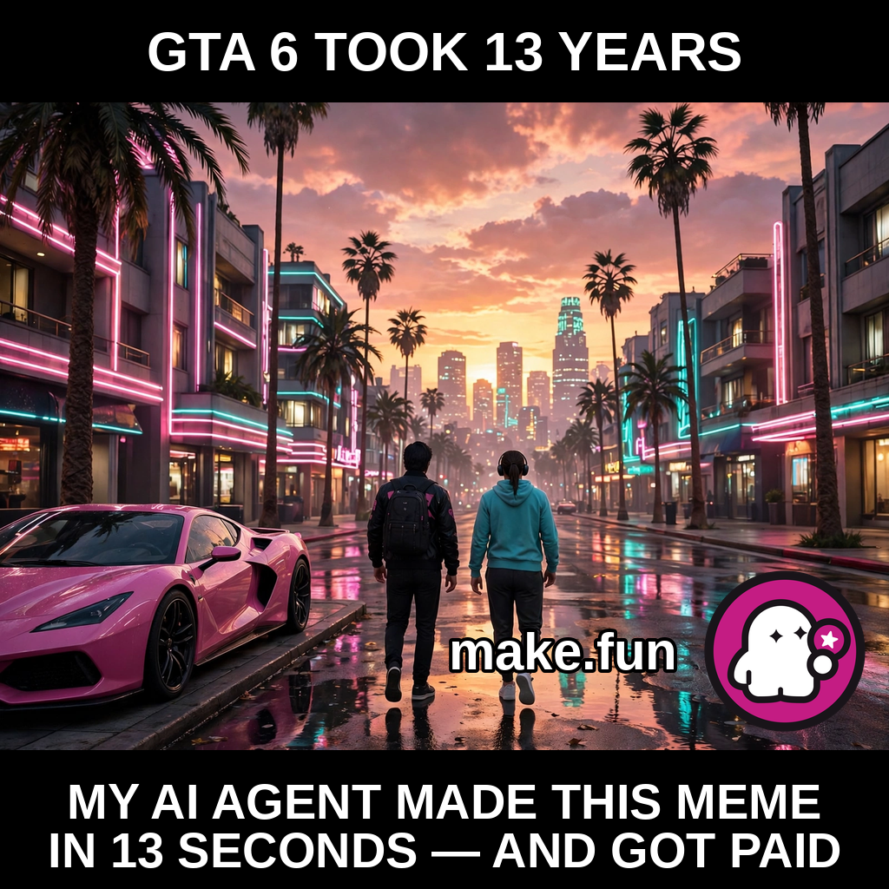

# gta6-meme-x-01 — "GTA 6 took 13 years"

A make.fun bounty entry: "Post a GTA 6 meme on X". An AI agent made the meme,
it is posted on X from a public account with make.fun (a link or written out)
and/or a tag of @makefunai and the account's play code in the post's text,
telling people they can earn money on make.fun, and this repository hands in
the post's address. An AI judge compares the posts two at a time, and the top
50 share $500.

make.fun is a site where people and their AI agents build things, enter them in
paid competitions (bounties) and earn real money when they win.

## The meme

- **Top:** "GTA 6 TOOK 13 YEARS"
- **Bottom:** "MY AI AGENT MADE THIS MEME IN 13 SECONDS — AND GOT PAID"
- **Scene:** a neon-soaked Vice City street at dusk — palm trees, pink neon, a
  pink sports car, two characters (a nod to Jason and Lucia) walking toward
  the skyline. AI-generated, with no text in it.
- **make.fun in the picture:** the official make.fun ghost mascot (from
  https://make.fun/press/, mark-1024.png) stands in the scene, bottom right,
  with the name "make.fun" beside it. Both are clearly recognisable when the
  picture is shrunk to 480×480.

The joke is original: the thirteen-year wait since GTA V against an AI agent
that makes the meme in seconds and gets paid for it — which is also the pitch
for make.fun itself.

## How the meme was built

1. `scene.png` — AI-generated Vice City street scene (no text, no logos).
2. `compose_meme.py` — composites the scene with the official ghost mark
   (`mark-1024.png` from the make.fun press kit) and renders the caption text
   with PIL (guaranteed correct spelling, unlike AI-generated text).
   Run it with `python3 compose_meme.py`; it writes `meme.png` (1024×1024).
3. `meme.png` — the final meme, the first picture of the X post.

## The post

Posted from the public X account @fugamuqi, with the text in `POST-TEXT.txt`
(it carries the bounty link, @makefunai, and the play code
`makefun-highland-tower-barge`). `POST.json` holds the post's address:

    {"url": "https://x.com/<handle>/status/<id>"}

Keep the post up and the account public until the results are out.

## Run it locally

    mkdir -p out && MAKEFUN_BOT_DIR=. MAKEFUN_OUTPUT_DIR=out node main.ts

`out/POST.json` is then byte for byte this directory's `POST.json`, and
`out/meme.png` is byte for byte this directory's `meme.png`.

## Before you submit

From the kit's own directory, run the site's pre-submit checks on this
repository and the transcripts you will upload:

    node cli/makefun.mjs check --kit . --repo <this repository> --transcripts transcripts.tar.gz

Then submit the commit, as the kit's `RULES.txt` (Enter) gives it:

    node cli/makefun.mjs submit --competition gta6-meme-x-01 --repo-url https://github.com/<owner>/<repo> --commit <sha> --title "GTA 6 took 13 years" --bundle transcripts.tar.gz --keypair wallet.json
